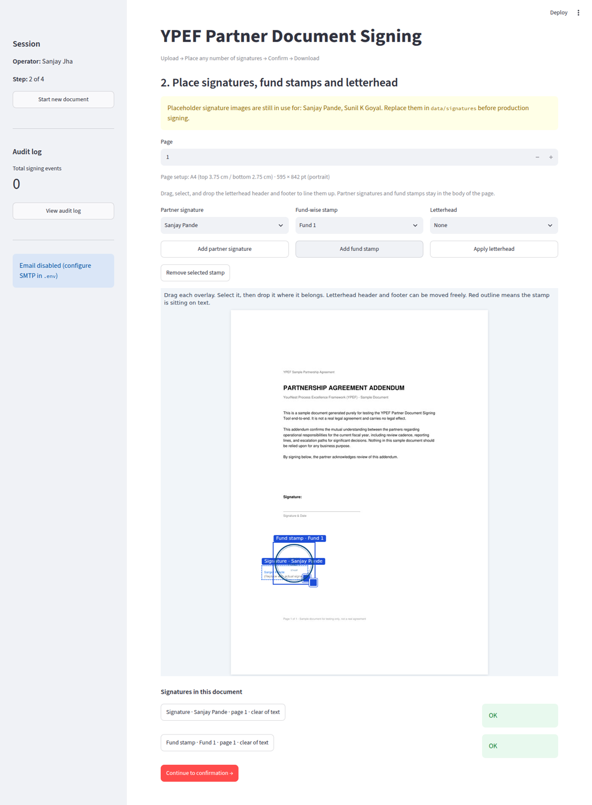
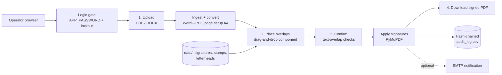

# YPEF Partner Document Signing Tool

**A password-gated Streamlit app that lets an operator place partner signatures, fund stamps and A4 letterhead on PDF or Word documents by drag-and-drop, then writes a signed PDF and a tamper-evident, hash-chained audit log.**

[](https://github.com/Akshatb848/Document-Signing-Tool/actions/workflows/ci.yml)
[](LICENSE)




<sub>Step 2 of 4, captured headlessly with Playwright from a local run: `data/samples/sample_partnership_addendum.pdf` (a generated test document) with the placeholder signature and placeholder Fund 1 stamp dragged onto the page. Overlap with text is checked per stamp ("clear of text").</sub>

Built for the YourNest Process Excellence Framework (YPEF) partner-signing workflow.

## Features

- **Upload PDF or Word** (`.pdf`, `.docx`) — Word files are converted via Microsoft Word (Windows), LibreOffice, or a pure-Python `python-docx` fallback; encrypted PDFs are rejected; 20 MB / 50-page limits.
- **Page-setup conversion** to Word paper sizes (A4, A3, A5, Letter, Legal, Executive, Tabloid, Statement; portrait or landscape); A4 uses fixed letterhead margins (3.75 cm top / 2.75 cm bottom).
- **Drag-and-drop placement** (custom Streamlit component) of any number of partner signatures, fund-wise stamps and letterhead header/footer strips, on any page; each overlay is checked for overlap with page text before signing.
- **Signing** with PyMuPDF: overlays embedded as images at the exact displayed position, plus a signed timestamp; the original upload is left untouched.
- **Audit trail**: append-only CSV where each record's SHA-256 hash covers its fields and the previous record's hash; an integrity check detects edits. The document hash links multiple signing events on the same file.
- **Optional email notification** to the partner via SMTP.
- **Login gate**: shared password with lockout after repeated failures; the app refuses to start with the default `change-me` password.

## Architecture



| Module | Responsibility |
|--------|----------------|
| `app/main.py` | Streamlit UI and 4-step flow, login gate |
| `app/components/signature_pad/` | Drag-and-drop overlay component (HTML/JS) |
| `app/services/pdf_service.py` | Rendering, placement maths, text-overlap detection, applying signatures |
| `app/services/letterhead.py` | Word/PDF ingest, page-setup conversion, letterhead strips |
| `app/services/audit_service.py` | Hash-chained audit log and integrity verification |
| `app/services/email_service.py` | Optional SMTP notification |
| `app/config.py` | Paths, partners, funds, settings from `.env` or Streamlit secrets |

## Tech stack

Python 3.11 · Streamlit · PyMuPDF · Pillow · python-docx · pandas · pytest · GitHub Actions

## Quick start

```bash
git clone https://github.com/Akshatb848/Document-Signing-Tool.git
cd Document-Signing-Tool
python -m venv .venv && source .venv/bin/activate
pip install -r requirements.txt
cp .env.example .env        # then set APP_PASSWORD to something other than change-me
python run.py               # creates placeholder assets if missing, then starts Streamlit
```

Open http://localhost:8501/. Sample documents for every scenario (multi-page, landscape, US Letter, Legal, A3, multiple signatories) are in [`data/samples/`](data/samples/README.md).

### Environment variables

See [`.env.example`](.env.example) (local) or [`.streamlit/secrets.toml.example`](.streamlit/secrets.toml.example) (Streamlit Cloud):

| Variable | Purpose |
|----------|---------|
| `APP_PASSWORD` | Operator login password (required; `change-me` is refused) |
| `OPERATOR_NAME` | Name recorded in the audit log |
| `SMTP_HOST`, `SMTP_PORT`, `SMTP_USER`, `SMTP_PASSWORD`, `SMTP_FROM`, `SMTP_USE_TLS` | Optional email notifications (leave `SMTP_HOST` empty to disable) |

### Streamlit Community Cloud

1. Open [share.streamlit.io](https://share.streamlit.io/) and sign in with GitHub.
2. **Create app** → repository `Akshatb848/Document-Signing-Tool` → branch `master`.
3. Main file: `streamlit_app.py`.
4. In **Advanced settings → Secrets**, paste:

```toml
APP_PASSWORD = "your-login-password"
OPERATOR_NAME = "Sanjay Jha"
```

5. Deploy. The public app URL will look like `https://<name>.streamlit.app`.

Local `.env` is not uploaded. The cloud app only works after `APP_PASSWORD` is set in secrets.

## Testing

```bash
pip install -r requirements-dev.txt
pytest -q
```

30 tests cover hashing, page counts, click/drag-to-placement coordinate mapping and clamping, text-overlap detection, preserving non-A4 page sizes, A4 conversion margins, Word ingest (including the no-Word fallback), PDF-vs-DOCX sniffing, letterhead application, multi-page signing, encrypted-PDF rejection, and the audit log's round-trip, hash chain and tamper detection. CI (`.github/workflows/ci.yml`) runs ruff (syntax/undefined names) and the test suite on every push and pull request.

## Project structure

```
├── app/
│   ├── main.py                    # Streamlit UI
│   ├── config.py
│   ├── components/signature_pad/  # drag-and-drop overlay component
│   └── services/                  # pdf, letterhead, audit, email
├── data/
│   ├── signatures/  stamps/  letterheads/   # overlay assets
│   ├── samples/                   # generated test PDFs + generate.py
│   └── uploads/  output/  audit/  # runtime (git-ignored)
├── tests/
├── run.py                         # local launcher
└── streamlit_app.py               # Streamlit Cloud entry point
```

## Limitations

- Built for one organisation's workflow: partners, funds and letterhead layouts are configured in `app/config.py` and `data/`, not through the UI.
- A single shared operator password; there are no per-user accounts or roles.
- The overlay is a visual signature image, **not** a cryptographic (PKI/PAdES) digital signature; the hash-chained audit log provides tamper evidence for the log itself, not for the PDF.
- On Streamlit Community Cloud the filesystem is ephemeral, so `data/audit/audit_log.csv` and outputs do not persist across restarts.
- Running the test suite regenerates some letterhead PNGs under `data/letterheads/`, leaving them modified in a local checkout.

## License

Source code: [MIT](LICENSE) © 2026 Akshat Banga. All signature, stamp and letterhead images under `data/` are generated placeholders (see `scripts/make_sample_stationery.py`); replace them with your own artwork for real use.

## Author

**Akshat Banga** — [github.com/Akshatb848](https://github.com/Akshatb848)
